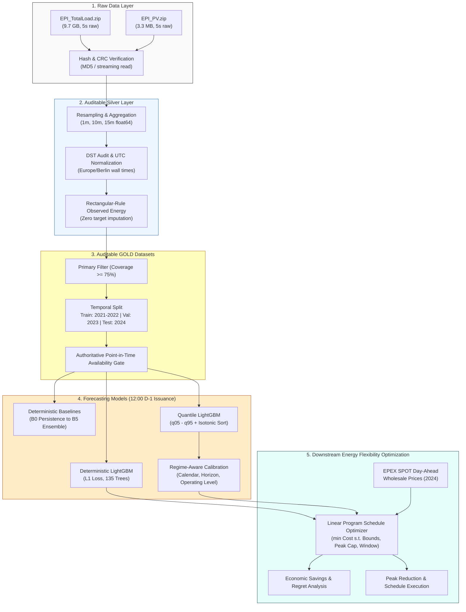

# Industrial Flexibility & Regime-Aware Load Forecasting

[](https://www.python.org/downloads/)
[](LICENSE)
[](https://www.kit.edu/)
[]()
[]()

> **Auditable Silver/Gold Data Engineering, Leakage-Safe Day-Ahead Operational Forecasting, Regime-Aware Probabilistic Calibration, and Price-Aware Industrial Flexibility Optimization on the KIT SPARK Benchmark.**

---

## Table of Contents

- [Executive Summary](#executive-summary)
- [Key Results at a Glance](#key-results-at-a-glance)
- [System Architecture & Workflow](#system-architecture--workflow)
- [Data Pipeline & Integrity Standards](#data-pipeline--integrity-standards)
  - [Raw Archives & Immutability](#raw-archives--immutability)
  - [DST Transition Policy](#dst-transition-policy)
  - [Silver & GOLD Aggregation](#silver--gold-aggregation)
  - [Chronological Split Protocol](#chronological-split-protocol)
- [Day-Ahead Forecasting Protocol](#day-ahead-forecasting-protocol)
- [Deterministic Forecasting Benchmark](#deterministic-forecasting-benchmark)
- [Probabilistic Calibration & Regime-Aware Analysis](#probabilistic-calibration--regime-aware-analysis)
  - [Quantile Modeling & Proper Scores](#quantile-modeling--proper-scores)
  - [Regime Conditioning & Holiday Stress Testing](#regime-conditioning--holiday-stress-testing)
- [Simulated Industrial Flexibility & Decision Layer](#simulated-industrial-flexibility--decision-layer)
  - [Decision Problem Formulation](#decision-problem-formulation)
  - [Economic & Peak-Demand Performance](#economic--peak-demand-performance)
  - [Sensitivity Matrix](#sensitivity-matrix)
- [Repository Structure](#repository-structure)
- [Step-by-Step Reproduction Guide](#step-by-step-reproduction-guide)
- [Provenance & Auditing](#provenance--auditing)

---

## Executive Summary

Industrial energy management requires reliable day-ahead load forecasts and decision-support algorithms that respect actual operational constraints and market schedules. This repository delivers an end-to-end, scientifically auditable machine learning and decision-layer system applied to the high-resolution **KIT SPARK (Smart Protection and Control in Industrial Microgrids)** benchmark:

1. **Rigorous Data Governance**: Processes over 9 GB of raw 5-second measurements across 4 years (2021–2024) into canonical 1-, 10-, and 15-minute Silver and GOLD parquet datasets without imputation, target fabrication, or data leakage.
2. **Point-in-Time Operational Protocol**: Emulates actual European Day-Ahead Market (EPEX SPOT) timing: forecasts are issued strictly at **12:00 Europe/Berlin on D-1** for all physical intervals of local day D, using only historical data completed by issuance.
3. **High-Performance Forecasting Models**:
   - **Deterministic LightGBM**: Achieves **2.352 kW MAE** and **15.31% WAPE** on the 2024 holdout test set (a **13.2% error reduction** over adaptive 4-week seasonal baselines).
   - **Probabilistic Calibration**: Evaluates quantile regressors ($q_{05}, q_{10}, q_{25}, q_{50}, q_{75}, q_{90}, q_{95}$) under proper scoring rules (Weighted Interval Score, CRPS). Global recalibration yields **89.91% empirical coverage** for the nominal 90% prediction interval on the 2024 test year with **20.7% narrower intervals** than empirical baselines.
4. **Regime-Aware Diagnosis**: Categorizes operating regimes across calendar types (weekdays, weekends, holidays, bridge days), forecast lead-time horizons (12h to 37h), and pre-issuance operational levels.
5. **Prescriptive Flexibility Optimization**: Optimizes a transparent shiftable-load envelope subject to shift windows, energy conservation, and peak-demand bounds. Under the primary operational scenario (20% flexible load, $\pm 2\,\text{h}$ shift window, $1.0\times$ peak cap), the **probabilistic schedule captures 51.3% of perfect-foresight savings** while guaranteeing zero peak-demand violations across all 274 test days.

---

## Key Results at a Glance

| Pipeline Stage | Benchmark / Baseline | Proposed Method | Relative Improvement / Outcome |
| :--- | :--- | :--- | :--- |
| **Deterministic Forecast** (2024 Test MAE) | 2.710 kW *(Adaptive B3 Baseline)* | **2.352 kW** *(LGBM Direct)* | **-13.2% MAE** ($p < 0.001$, paired bootstrap) |
| **90% Interval Coverage** (2024 Test) | 88.77% (width: 13.81 kW) *(B3)* | **89.91%** (width: **10.95 kW**) *(R0 Global)* | **Exact nominal coverage** with **20.7% narrower width** |
| **Holiday Probabilistic WIS** | 6.443 *(B3 Empirical)* | **2.175** *(R0 Global)* | **-66.2% error** on holiday shifts |
| **Flexibility Economic Efficiency** | 42.48% *(B3 Schedule)* | **51.30%** *(Probabilistic Schedule)* | **+8.82 pp** closer to perfect foresight |
| **Flexibility Maximum Regret** | €0.317 / day *(B3)* | **€0.183 / day** *(Probabilistic)* | **-42.3% peak financial regret** |
| **Peak Cap Violations** | Standard unconstrained shift | **0 days** (Guaranteed by design) | Strict doubly-stochastic routing formulation |

---

## System Architecture & Workflow

The entire repository follows an auditable, progressive pipeline architecture:



---

## Data Pipeline & Integrity Standards

### Raw Archives & Immutability
All raw inputs originate from official Karlsruhe Institute of Technology (KIT) industrial microgrid measurements:
- `data/raw/EPI_TotalLoad.zip`: 9,701,876,967 bytes (MD5 `cbbffe29f9d8e224b9221cb5904a00bb`)
- `data/raw/EPI_PV.zip`: 3,272,618 bytes (MD5 `f34a321b3aee4beca9864c09c68b2e36`)

The pipeline validates sizes and MD5 sums on every run, never unpacks raw archives permanently to disk, and uses streaming readers to generate downstream Parquet datasets.

### DST Transition Policy
Source timestamps are recorded in naive Europe/Berlin local time.
- **Spring Transition (March)**: Nonexistent local wall-time timestamps (02:00–02:59) cannot map to physical UTC and are flagged and excluded from UTC aggregates.
- **Autumn Transition (October)**: A single unlabelled 02:00 hour occurs in the source. Because the physical fold is unlabelled, policy assigns it to the first (CEST) fold while marking the second fold as missing.
- **Zero Fabrication**: No missing sample is imputed, forward-filled, or smoothed in Silver data.

### Silver & GOLD Aggregation
Every 15-minute interval retains mean, standard deviation, min, max, median, 5th/25th/75th/95th percentiles, valid/expected counts, and quality flags. Energy is computed strictly via the rectangular rule over valid 5-second measurements:

$$E_{\text{obs}} = \frac{P_{\text{mean}}}{1000} \cdot N_{\text{valid}} \cdot \frac{5}{3600} \quad [\text{kWh}]$$

The **GOLD** dataset enforces the primary research rule: $\ge 75\%$ coverage threshold (135 out of 180 valid 5-second samples per 15-minute interval).

### Chronological Split Protocol
To prevent data snooping and evaluate realistic model deployment under distribution shifts, the data is partitioned chronologically:
- **TRAIN**: 2021-01-01 to 2022-12-31 (730 days, 69,832 primary target observations)
- **VALIDATION**: 2023-01-01 to 2023-12-31 (365 days, 32,676 primary target observations)
- **TEST (Holdout)**: 2024-01-01 to 2024-12-31 (366 days, 31,339 primary target observations)

A substantial temporal distribution shift is observed between splits: average load increases from **12.65 kW (Train)** to **15.36 kW (Test)** (+21.5%), with the 95th percentile rising from 28.14 kW to 32.43 kW.

---

## Day-Ahead Forecasting Protocol

To emulate authentic European day-ahead power markets, forecasts are issued under a strict point-in-time causality gate:
1. **Issuance Window**: Exactly at **12:00 Europe/Berlin on D-1**.
2. **Forecast Horizon**: All physical 15-minute intervals of calendar day D (92 intervals on spring DST change, 96 intervals on normal days, 100 intervals on autumn DST change; lead times range from 12.0 to 37.0 hours).
3. **Information Set**: Historical load is available *only* after its interval has ended. At 12:00 D-1, only intervals ending at or before 12:00 D-1 can be used. Target-day weather forecasts, future PV generation, and unverified prices are strictly excluded from the feature set.

---

## Deterministic Forecasting Benchmark

Six deterministic models and baselines were compared on common primary-quality targets on the 2024 holdout test set (31,339 evaluated quarter-hours across 366 days). Confidence intervals are computed using stationary block bootstrap (1,000 resamples):

| Model / Baseline | Description | Test MAE (kW) | 95% CI (MAE) | Test RMSE (kW) | WAPE (%) | Bias (kW) |
| :--- | :--- | :---: | :---: | :---: | :---: | :---: |
| **LGBM_DIRECT** | LightGBM Direct L1 (135 trees) | **2.352** | **[2.224, 2.481]** | **3.466** | **15.31%** | -0.437 |
| **B5_baseline_ensemble** | Median of B1, B2, B3 | 2.571 | [2.379, 2.768] | 4.152 | 16.48% | -0.108 |
| **B3_recent_week_profile** | 4-week median same-quarter | 2.710 | [2.510, 2.912] | 4.232 | 17.64% | +0.003 |
| **B2_weekly** | Exact same quarter 7 days prior | 2.854 | [2.613, 3.083] | 4.813 | 22.25% | -0.102 |
| **B4_calendar_profile** | Train-only month/DoW/QoD median | 3.039 | [2.828, 3.253] | 4.492 | 23.46% | -0.379 |
| **B1_safe_recent_day** | Recent available day same quarter | 4.749 | [4.425, 5.067] | 7.812 | 36.66% | -0.003 |
| **B0_persistence** | Last available interval before 12:00 | 9.553 | [8.972, 10.118] | 12.487 | 73.75% | +6.505 |

### Paired Comparison
On identical evaluated targets, `LGBM_DIRECT` achieves a **mean daily MAE improvement of 0.358 kW** over `B3_recent_week_profile` ([0.260, 0.461] kW 95% CI) and **wins on 73.2% of paired test days**.

---

## Probabilistic Calibration & Regime-Aware Analysis

### Quantile Modeling & Proper Scores
Seven LightGBM quantile regression models were trained for nominal probabilities $\tau \in \{0.05, 0.10, 0.25, 0.50, 0.75, 0.90, 0.95\}$ on 2021–2022, stopped and calibrated on 2023, and evaluated on the 2024 holdout. Quantiles are post-processed with isotonic sorting to guarantee monotonicity ($q_\alpha \le q_\beta$ for $\alpha < \beta$).

Scores on the 2024 Test Holdout (31,339 targets):

| Calibration Method | Mean Pinball Loss | WIS (Proper Score) | CRPS (Approx) | 50% Coverage (Nominal 50%) | 80% Coverage (Nominal 80%) | 90% Coverage (Nominal 90%) | 90% Mean Width (kW) |
| :--- | :---: | :---: | :---: | :---: | :---: | :---: | :---: |
| **PB0_B3_empirical** | 0.9231 | 1.8463 | 2.0449 | 49.02% | 78.61% | 88.77% | 13.806 |
| **PB1_LGBM_empirical** | 0.7636 | 1.5272 | 1.7117 | 45.94% | 79.20% | 89.09% | 11.717 |
| **R0_GLOBAL_CALIBRATION** | **0.7372** | **1.4743** | **1.7099** | **50.06%** | **80.44%** | **89.91%** | **10.950** |
| **R1_CALENDAR_CONDITIONAL** | 0.7350 | 1.4700 | 1.7027 | 50.46% | 80.44% | 90.05% | 11.111 |
| **R2_HORIZON_CONDITIONAL** | 0.7369 | 1.4739 | 1.7094 | 50.09% | 80.43% | 89.79% | 11.034 |
| **R3_LEVEL_CONDITIONAL** | 0.7384 | 1.4769 | 1.7087 | 47.69% | 79.87% | 90.09% | 11.108 |
| **R4_HIERARCHICAL** | 0.7323 | 1.4646 | 1.6938 | 47.76% | 80.54% | 90.09% | 11.068 |

*Note: `R0_GLOBAL_CALIBRATION` was frozen a priori based on validation selection. It delivers virtually perfect 50% (50.06%), 80% (80.44%), and 90% (89.91%) calibration.*

### Regime Conditioning & Holiday Stress Testing
While global calibration achieves nominal coverage on average, stress-testing on extreme operational regimes reveals distinct failure modes in naive models:

| Model on 2024 Public Holidays | Holiday WIS | Holiday 90% Coverage (Nominal 90%) | Holiday 90% Mean Width (kW) | Holiday q50 MAE (kW) |
| :--- | :---: | :---: | :---: | :---: |
| **PB0_B3_empirical** | 6.443 | 44.68% *(Severe Undercoverage)* | 13.806 | 8.254 |
| **PB1_LGBM_empirical** | 2.266 | 69.91% | 11.717 | 3.478 |
| **R0_GLOBAL_CALIBRATION** | **2.175** | **68.29%** | **15.661** | **3.397** |
| **R1_CALENDAR_CONDITIONAL** | **2.105** | **64.00%** | **14.386** | **3.334** |

---

## Simulated Industrial Flexibility & Decision Layer

### Decision Problem Formulation
The prescriptive decision layer couples forecasted load profiles with the **German Day-Ahead Wholesale Electricity Market (EPEX SPOT)** to optimize industrial demand response without disrupting daily operations.

Let origin interval be $i \in \{1,\dots,T\}$, destination interval be $t \in \{1,\dots,T\}$, and scenario be $s \in \mathcal{S}$. For an operational day with flexible fraction $f$ and shift window $W$:
- Inflexible load: $B_{t,s} = (1 - f) L_{t,s}$
- Flexible load: $F_{i,s} = f L_{i,s}$
- Routing matrix: $a_{i,t} \ge 0$, representing the fraction of flexible energy from interval $i$ shifted to interval $t$.

$$\min_{a} \sum_{s \in \mathcal{S}} w_s \sum_{t=1}^T P_t \left[ (1 - f) L_{t,s} + \sum_{i: |i - t| \le W} a_{i,t} f L_{i,s} \right] \Delta t$$

Subject to:
1. **Energy Conservation**: $\sum_{t: |i - t| \le W} a_{i,t} = 1 \quad \forall i$
2. **Physical Shift Window**: $a_{i,t} = 0 \quad \text{for } |i - t| > W$
3. **Doubly-Stochastic Peak Demand Cap**: At cap multiplier $c = 1.0$, the column constraint $\sum_i a_{i,t} \le 1.0$ guarantees that the resulting schedule **can never increase peak electrical power** for any realized nonnegative load profile.

### Economic & Peak-Demand Performance
Evaluated across **274 complete, price-verified holdout days in 2024** under the **Primary Operational Scenario** (20% flexible load, $\pm 2\,\text{h}$ shift window, $1.0\times$ peak cap):

| Policy / Forecast Method | Daily Cost (€) | Daily Savings (€) | Savings (%) | Mean Regret (€) | Max Regret (€) | Forecast Efficiency | Peak Reduction (kW) | Cap Violations |
| :--- | :---: | :---: | :---: | :---: | :---: | :---: | :---: | :---: |
| **D0_NO_FLEX** (Uncontrolled) | €28.382 | €0.000 | 0.00% | €0.125 | €2.955 | 0.00% | 0.000 | 0 |
| **D1_PERFECT_FORESIGHT** (Oracle) | €28.257 | €0.125 | 0.427% | €0.000 | €0.000 | 100.00% | 0.851 kW | 0 |
| **B3_SCHEDULING** (Baseline Profile) | €28.298 | €0.084 | 0.243% | €0.041 | €0.317 | 42.48% | 0.793 kW | 0 |
| **D2_DETERMINISTIC** (LGBM Direct) | €28.292 | €0.090 | 0.280% | €0.035 | €0.233 | 48.08% | 0.750 kW | 0 |
| **D3_PROBABILISTIC** ($q_{10}, q_{50}, q_{90}$) | **€28.291** | **€0.091** | **0.280%** | **€0.033** | **€0.183** | **51.30%** | **0.749 kW** | **0** |

*Key Findings:*
- **Probabilistic Scheduling Leads**: Optimizing over quantile support points ($q_{10}, q_{50}, q_{90}$ weighted 0.2 / 0.6 / 0.2) achieves the highest forecast efficiency (**51.30%**), lowest mean regret (**€0.033/day**), and lowest maximum regret (**€0.183/day**, a 42.3% reduction compared to baseline scheduling).
- **Peak Load Guarantee**: Because of the doubly-stochastic column constraint formulation, realized peak demand was reduced by an average of **0.75 kW** with **zero cap violations** across the entire year.

### Sensitivity Matrix
Impact of varying flexible load fraction $f$ and physical shift window $W$ on the 2024 holdout test set:

| Flexible Load Fraction ($f$) | Shift Window ($W$) | Power Cap Mult | Realized Savings (€/day) | Savings (%) | Energy Shifted (kWh/day) | Peak Reduction (kW) |
| :---: | :---: | :---: | :---: | :---: | :---: | :---: |
| 5% | $\pm 1\,\text{h}$ | $1.0\times$ | €0.005 | 0.017% | 0.711 | 0.157 |
| 5% | $\pm 2\,\text{h}$ | $1.0\times$ | €0.023 | 0.070% | 1.101 | 0.202 |
| 5% | $\pm 4\,\text{h}$ | $1.0\times$ | €0.082 | 0.249% | 2.493 | 0.328 |
| 10% | $\pm 1\,\text{h}$ | $1.0\times$ | €0.011 | 0.034% | 1.437 | 0.327 |
| 10% | $\pm 2\,\text{h}$ | $1.0\times$ | €0.046 | 0.139% | 2.207 | 0.405 |
| 10% | $\pm 4\,\text{h}$ | $1.0\times$ | €0.164 | 0.498% | 4.986 | 0.625 |
| **20% (Primary)** | $\pm 1\,\text{h}$ | $1.0\times$ | €0.021 | 0.069% | 2.865 | 0.636 |
| **20% (Primary)** | **$\pm 2\,\text{h}$** | **$1.0\times$** | **€0.091** | **0.280%** | **4.417** | **0.749** |
| **20% (Primary)** | $\pm 4\,\text{h}$ | $1.0\times$ | €0.327 | 0.996% | 9.964 | 1.143 |
| 30% | $\pm 1\,\text{h}$ | $1.0\times$ | €0.032 | 0.101% | 4.279 | 0.856 |
| 30% | $\pm 2\,\text{h}$ | $1.0\times$ | €0.137 | 0.420% | 6.640 | 1.087 |
| 30% | $\pm 4\,\text{h}$ | $1.0\times$ | €0.491 | 1.493% | 14.939 | 1.561 |

---

## Repository Structure

```text
Industrial_energy_forecasting/
├── config/
│   ├── baseline_experiment.json        # Frozen baseline configuration
│   ├── flexibility_simulation.json     # Flexibility optimization parameters
│   ├── lightgbm_frozen.json            # Frozen deterministic LightGBM specs
│   ├── pipeline_config.json            # Central pipeline parameters
│   └── regime_probabilistic_frozen.json# Frozen probabilistic quantile specs
├── data/
│   ├── raw/                            # Immutable official ZIP archives
│   ├── silver/                         # Audited 1m, 10m, 15m Parquet data
│   └── gold/                           # Analysis-ready train/val/test panels
├── docs/
│   ├── gold_data_dictionary.md         # Schema and provenance of GOLD
│   ├── gold_feature_availability.md    # Point-in-time leakage audit
│   ├── lightgbm_feature_dictionary.md  # Predictor dictionary and definitions
│   └── silver_data_dictionary.md       # Silver schema and quality indicators
├── reports/
│   ├── day_ahead_baselines.md          # Deterministic baseline benchmark report
│   ├── deterministic_lightgbm.md       # Deterministic LightGBM results
│   ├── flexibility_optimization.md     # Decision & flexibility simulation study
│   ├── gold_summary.md                 # GOLD construction & split summary
│   ├── missingness_reliability_study.md# Missingness pattern audit
│   ├── probabilistic_lightgbm.md       # Quantile regression & scores report
│   ├── regime_aware_probabilistic.md   # Regime-conditioned calibration report
│   └── silver_summary.md               # Raw-to-Silver validation audit
├── results/
│   ├── baselines/                      # Baseline metrics and figure plots
│   ├── flexibility/                    # Daily simulation tables and figures
│   │   └── figures/                    # Shift schedules, cost, regret curves
│   ├── lightgbm/                       # Model logs, importance, residual plots
│   ├── probabilistic/                  # Quantile metrics, reliability fans
│   └── regime_probabilistic/           # Scorecards and regime calibration plots
├── src/
│   ├── download_raw.py                 # Immutable archive download helper
│   ├── resample_total_load.py          # 5s streaming resampler for load
│   ├── resample_pv.py                  # 5s streaming resampler for PV
│   ├── audit_dst.py                    # DST transition anomaly auditor
│   ├── analyze_missingness.py          # Missingness & gap duration analysis
│   ├── validate_silver.py              # Schema & statistical invariant tests
│   ├── build_gold.py                   # Train/Val/Test gold panel builder
│   ├── day_ahead_baselines.py          # Point-in-time baseline benchmark
│   ├── day_ahead_features.py           # Safe feature engineering engine
│   ├── train_lightgbm.py               # Deterministic LightGBM trainer
│   ├── probabilistic_lightgbm.py       # Quantile regressors & isotonic sort
│   ├── regime_probabilistic.py         # Regime detection & calibration
│   └── flexibility_optimization.py     # Linear program demand flexibility solver
├── tests/
│   ├── test_day_ahead_leakage.py       # Unit tests for point-in-time causality
│   ├── test_flexibility_optimization.py# Unit tests for conservation & peak caps
│   ├── test_probabilistic_calibration.py# Unit tests for quantile monotonicity
│   └── test_silver_pipeline.py         # Invariant & checksum unit tests
├── requirements.txt                    # Project dependencies
└── README.md                           # Master documentation
```

---

## Step-by-Step Reproduction Guide

### 1. Environment Setup
Clone the repository and install the verified environment:

```bash
git clone https://github.com/MhdAsker/Industrial_flexibilty_regime_aware_forecasting.git
cd Industrial_flexibilty_regime_aware_forecasting
python -m venv .venv
source .venv/bin/activate  # On Windows: .venv\Scripts\activate
pip install -r requirements.txt
```

### 2. Auditable Data Ingestion & Transformation
Verify raw archives (or safely stream them if absent), resample to Silver standard, and compile the GOLD panels:

```bash
# Verify or acquire raw archives
python src/download_raw.py total_load
python src/download_raw.py pv

# Execute Silver resamplers and audits
python src/resample_total_load.py
python src/resample_pv.py
python src/audit_dst.py
python src/analyze_missingness.py
python src/validate_silver.py
python src/missingness_reliability.py
python src/canonicalize_exogenous.py

# Build analysis-ready GOLD datasets
python src/build_gold.py
```

### 3. Run Validation Unit Tests
Execute the comprehensive test suite verifying leakage gates, checksums, and optimization bounds:

```bash
pytest -v
```

### 4. Deterministic Forecasting
Train and evaluate seasonal baselines and deterministic LightGBM:

```bash
# Benchmark leakage-safe baselines
python src/day_ahead_baselines.py

# Construct point-in-time features & train LightGBM
python src/day_ahead_features.py
python src/train_lightgbm.py
```

### 5. Probabilistic Forecasting & Regime Calibration
Train quantile models, execute isotonic monotonicity sorting, and compute regime-aware calibration:

```bash
python src/probabilistic_lightgbm.py
python src/regime_probabilistic.py
```

### 6. Downstream Energy Flexibility Optimization
Simulate ex-post price-aware load shifting under physical constraints:

```bash
python src/flexibility_optimization.py
```

---

## Provenance & Auditing

- **Dataset Credit**: High-resolution measurements provided by the **Karlsruhe Institute of Technology (KIT)** Energy Lab / SPARK industrial microgrid project.
- **Auditing Integrity**: Every dataset and experiment writes a sibling `.json` run manifest recording code git commit hash, configuration SHA-256, input archive CRC/MD5, output SHA-256, and random seeds.
- **License**: MIT License. See `LICENSE` for details.
